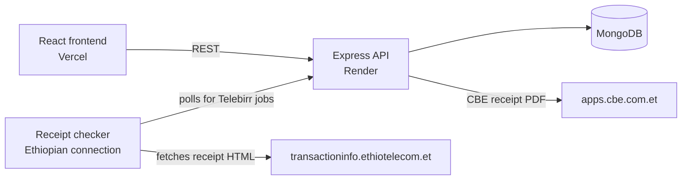

# Haramaya Delivery: Backend API

REST API for a campus delivery platform in Ethiopia. Students order from the Harar and Dire Dawa markets, pay with **Telebirr** or **CBE**, and collect at one pickup point on campus.

**Live API:** https://haramaya-delivery-backend.onrender.com
**Frontend:** [haramaya-delivery-frontend](https://github.com/yaredkumera/haramaya-delivery-frontend) · **Live site:** https://hu-delivery.vercel.app

> The live API runs on a free Render instance, so the first request after a quiet period can take up to a minute.

## Highlights

- **Automatic payment verification.** The customer pays outside the app and enters the transaction ID. The API reads the official receipt (CBE: PDF, Telebirr: HTML) and checks the transaction ID, amount, receiver account, payer name and payment age. If everything matches, the order is approved automatically.
- **Manual review fallback.** If a receipt cannot be read or does not match, the order waits in an admin review queue, with the reasons listed.
- **Duplicate protection.** A transaction ID can only be used for one order.
- **Admin workflow.** Approve or reject payments, mark orders ready, and hand over using the pickup code.
- **Orders by role.** Students see their own orders. Admins see everything.

## Architecture



### Why a separate checker for Telebirr?

The Telebirr receipt site did not accept connections from the cloud host's servers abroad, so the same code that worked locally timed out in production. A small checker program on a machine with an Ethiopian connection asks the API for pending Telebirr orders, downloads the receipt pages itself, and sends the HTML back. The API still does all the parsing and checks, so the trust logic stays in one place. If the checker is offline, orders simply wait for manual review.

## Tech stack

Node.js · Express · TypeScript · MongoDB (Mongoose) · cheerio (HTML parsing) · pdf-parse (PDF parsing)

## Getting started

```bash
git clone https://github.com/yaredkumera/haramaya-delivery-backend.git
cd haramaya-delivery-backend
npm install
cp .env.example .env     # then fill in the values
npm run dev
```

Build for production:

```bash
npm run build
npm start
```

## Environment variables

Copy `.env.example` to `.env` and fill in every value. Never commit `.env`.

## Payment flow

1. The customer sends money to the shop's Telebirr number or CBE account.
2. The customer enters the transaction ID and the name on the paying account at checkout.
3. The order is created with status **review**.
4. CBE receipts are read directly. Telebirr receipts are read by the receipt checker.
5. Checks: matching ID, amount, receiver, payer name, and payment time.
6. All checks pass: **paid**. Otherwise: stays in **review** with reasons for an admin.

## Roadmap

- Password reset and email notifications
- Automated tests for the receipt-checking logic
- Stock quantities and admin analytics

## Author

**Yared Kumera**: [GitHub](https://github.com/yaredkumera)